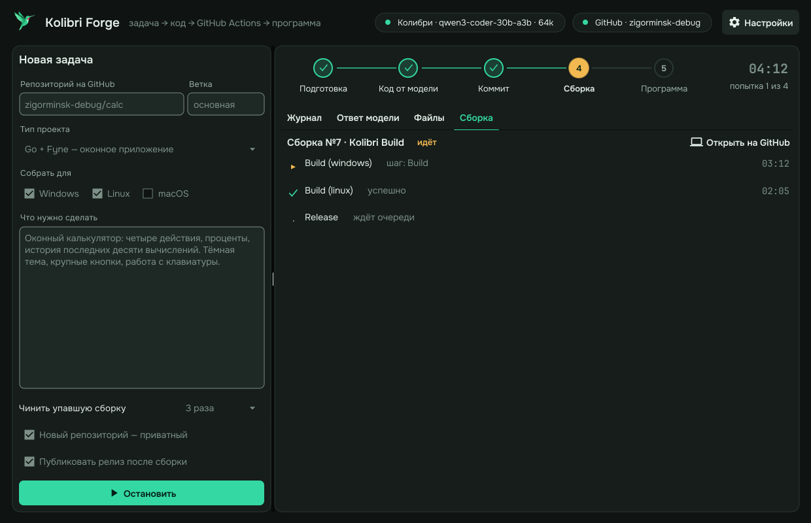
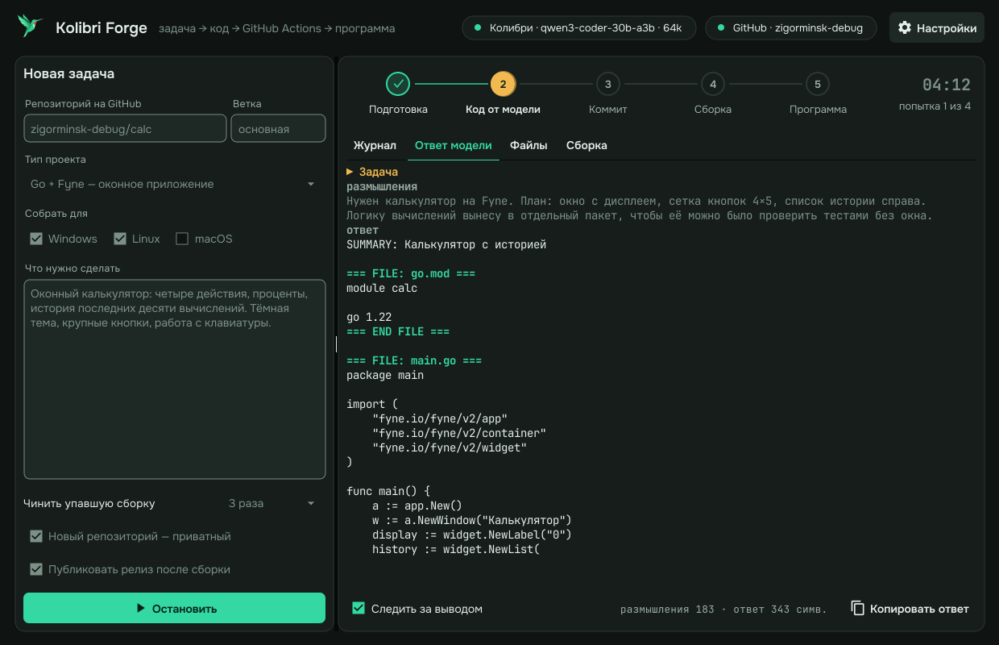
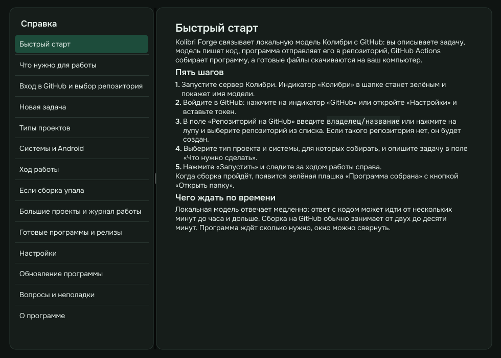

# Kolibri Forge

Программа на Go + Fyne, которая связывает локальную модель [colibrì](https://github.com/JustVugg/colibri) с GitHub:
вы описываете задачу, Колибри пишет код, Kolibri Forge отправляет его в репозиторий, GitHub Actions собирает программу,
а готовые файлы скачиваются на ваш компьютер.



## Как это работает

1. **Подготовка.** Проверяется связь с Колибри (`http://127.0.0.1:8000`) и токен GitHub. Если репозитория или ветки нет, они создаются.
2. **Код от модели и поиск в интернете.** Задача уходит в Колибри через её OpenAI-совместимый API (`/v1/chat/completions`, потоковый режим). Когда модели нужно изучить устройство программы, протокола или библиотеки, она поручает Kolibri Forge конкретные действия в браузере [Lightpanda](https://github.com/lightpanda-io/browser); программа выполняет их, возвращает собранные данные модели и повторяет цикл столько раз, сколько нужно, пока все файлы проекта не будут готовы.
3. **Коммит.** Файлы из ответа записываются в GitHub одним коммитом вместе с файлом сборки `.github/workflows/kolibri-build.yml` и записью в журнале работы `.kolibri/worklog.md`. Сборка на GitHub Actions стартует сразу после этого коммита.
4. **Сборка.** Программа следит за запуском и показывает ход по каждой операционной системе.
5. **Исправление.** Если сборка упала, журнал ошибки отправляется модели, и она присылает исправленные файлы. Число попыток задаётся в форме (от 0 до 5).
6. **Программа.** После успешной сборки артефакты скачиваются в `~/KolibriForge/<репозиторий>/build-<номер>/`. При включённой галочке на GitHub публикуется релиз.



## Что нужно

- Запущенный сервер Колибри. По [инструкции colibrì](https://github.com/JustVugg/colibri/blob/main/docs/quickstart.md) это `START-HERE.bat` на Windows или `./start-here.sh` на Linux и macOS; сервер слушает `http://127.0.0.1:8000`.
- Токен GitHub:
  - classic — с областями `repo` и `workflow`;
  - fine-grained — с правами Contents и Workflows (Read and write) и Actions (Read).

  Без права `workflow` GitHub не даст записать файл сборки. В настройках есть ссылка, которая открывает страницу создания токена с нужными областями.

## Где взять программу

Каждое изменение в этом репозитории собирается на GitHub Actions (workflow **Build**):

- на странице запуска в разделе Artifacts лежат `KolibriForge-windows-amd64`, `KolibriForge-linux-amd64` и `KolibriForge-macos-arm64`;
- для ветки `main` и тегов `v*` дополнительно публикуется релиз с теми же файлами.

В артефакте для Windows два файла: установщик `KolibriForge-Setup.exe` и архив `KolibriForge-windows-amd64.zip` с программой без установки.

Запуск:

| Система | Что делать |
|---|---|
| Windows | Запустить `KolibriForge-Setup.exe`: он ставит программу в профиль пользователя без прав администратора, создаёт ярлык в меню «Пуск» (и на рабочем столе, если отметить) и запись в «Установленных приложениях» для удаления. Повторный запуск новой версии обновляет установленную. Без установки — распаковать zip и запустить `Kolibri Forge.exe`. Файлы не подписаны, поэтому SmartScreen покажет предупреждение: «Подробнее» → «Выполнить в любом случае». |
| Linux | `tar -xzf KolibriForge-linux-amd64.tar.gz && ./KolibriForge/kolibri-forge` |
| macOS | Распаковать архив и открыть `Kolibri Forge.app` через правый клик → «Открыть»: программа не нотаризована. |

## Первый запуск

1. Откройте «Настройки», вставьте токен GitHub и нажмите «Проверить токен». Адрес Колибри по умолчанию уже `http://127.0.0.1:8000`.
2. В форме слева укажите репозиторий в виде `владелец/название` или нажмите на лупу в этом поле и выберите его из списка. Если репозитория нет, он будет создан.
3. Выберите тип проекта и системы, для которых собирать: Windows, Linux, macOS, Android.
4. Опишите задачу и нажмите «Запустить».

Индикаторы в шапке показывают связь с Колибри и GitHub; нажатие на индикатор повторяет проверку.

## Поиск в интернете через Lightpanda

При включённой галочке «Поиск в интернете (Lightpanda)» задачу можно формулировать сразу как исследование и разработку — например: _«посмотри как устроена программа Radmin VPN и сделай аналогичную для локального использования»_.

1. Колибри анализирует задачу и, если ей не хватает сведений, возвращает блок `=== WEB ===` с конкретными действиями (`search`, `open`, `links`, `extract`, `click`, `fill`, `press`, `scroll`, `wait`, `elements`, `tree`, `structured_data`, `html`, `evaluate`).
2. Kolibri Forge выполняет эти действия в безголовом браузере [Lightpanda](https://github.com/lightpanda-io/browser) по его родному протоколу MCP (с выполнением JavaScript и извлечением Markdown/DOM) и передаёт результаты обратно модели в блоке `=== WEB RESULTS ===`.
3. Модель пишет код и при необходимости снова запрашивает информацию из интернета (в том числе в смешанных ответах, где часть файлов уже готова, и при исправлении упавшей сборки), пока проект целиком не будет готов к коммиту в GitHub.
4. Все шаги браузера отображаются на вкладке «Интернет» и кратко записываются в `.kolibri/worklog.md`.

На **Windows** поиск и чтение сайтов работают сразу «из коробки» без WSL2 и Docker: в Kolibri Forge встроен нативный движок, реализующий все команды Lightpanda (парсер HTML5 DOM, CSS3-селекторы, преобразование страниц в чистый Markdown с удалением навигационного шума, извлечение таблиц, кода, ссылок, JSON-LD и метаданных, заполнение и отправку форм с cookies, `robots.txt`, каскад поиска Brave / Tavily / Exa / Parallel / Keenable / DuckDuckGo и автоматический безголовый рендеринг динамических SPA-страниц через Microsoft Edge или Chrome). На Linux и macOS кнопкой «Установить Lightpanda» в «Настройках» скачивается официальный исполняемый файл (а при настроенных WSL2, Docker или внешнем `lightpanda mcp --port 9222` программа автоматически использует их). Телеметрия отключена, токены в процесс браузера не передаются, обращения к `localhost` и локальным сетям блокируются.

## Чтение скриншотов ошибок

Когда тестируемая программа падает или показывает окно с ошибкой, снимок экрана можно приложить прямо к задаче (до 6 изображений `.png`, `.jpg`, `.jpeg`, `.bmp`, `.gif`):

- кнопкой **«Скриншот»** над полем задачи;
- кнопкой **«Буфер»** сразу после `Win+Shift+S` или `PrintScreen`;
- перетаскиванием файла изображения в окно программы.

По нажатию на прикреплённый снимок открывается предпросмотр; крупные изображения автоматически масштабируются под лимит запроса Колибри с сохранением читаемости текста и стека вызовов. Мультимодальным моделям Колибри (Qwen 3.6/3.8, GLM 5.3, DeepSeek 4.1, MiMo, Mistral Large 4 / LFM3 с `--mmproj`) снимки передаются напрямую, а если загружена текстовая модель — программа автоматически распознаёт текст с изображения средствами системы (`Windows.Media.Ocr` на Windows 10/11, Vision на macOS, `tesseract` на Linux) и передаёт его модели для исправления кода.

## Справка



Кнопка «?» в шапке открывает справку в отдельном окне, его можно держать рядом с основным. В ней шестнадцать разделов: быстрый старт, что нужно для работы, вход в GitHub, форма задачи, типы проектов, системы и Android, поиск в интернете и Lightpanda, чтение скриншотов ошибок, ход работы, исправление сборки, журнал работы, готовые программы и релизы, настройки, обновление, неполадки и «О программе» с версией и контактами разработчика. Текст справки лежит в `internal/ui/assets/help.md` и встроен в программу.

## Обновления

При запуске программа спрашивает у GitHub список релизов этого репозитория и сравнивает его со своей версией и номером сборки. Запрос идёт без токена. Если есть более новый релиз, под шапкой появляется полоса «Доступно обновление»:

- «Подробнее» показывает описание релиза и текущую версию; там же можно пропустить эту версию, чтобы о ней больше не напоминали;
- «Скачать» открывает в браузере файл для вашей системы: на Windows — `KolibriForge-Setup.exe`, на Linux и macOS — архив; если такого файла в релизе нет, открывается страница релиза.

Сама программа ничего не скачивает и не устанавливает. Сначала предлагается версия с тегом `vX.Y.Z` новее текущей, а если такой нет — промежуточная сборка `build-N` с номером больше текущего. Напоминания о промежуточных сборках и проверку при запуске можно отключить в «Настройках»; там же и в разделе «О программе» справки есть кнопка «Проверить обновления». Программа, собранная из исходников без упаковки, своей версии не знает и при запуске ничего не проверяет.

## Выбор репозитория и вход в GitHub

Лупа в поле «Репозиторий на GitHub» открывает список ваших репозиториев — личных и тех, куда у вас есть доступ, — с поиском по названию и описанию. Свежие изменения идут первыми; у каждого видно, приватный ли он и можно ли в него писать. Поле «Ветка» при выборе очищается: работа пойдёт в основной ветке репозитория, её имя показано в поле подсказкой.

Если токена нет, GitHub его не принял или его прав не хватает, чтобы показать список, открывается окно «Вход в GitHub». Войти можно двумя способами:

- **Токен.** Вставьте его в окне; ссылка рядом открывает страницу GitHub, где нужные области уже отмечены.
- **Через браузер, без токена.** Программа показывает код, вы вводите его на `github.com/login/device` и подтверждаете доступ. Этот способ GitHub разрешает только зарегистрированным приложениям, поэтому сначала создайте своё: GitHub → Settings → Developer settings → OAuth Apps → New OAuth App, включите «Enable Device Flow» и вставьте его Client ID в «Настройках». Пока Client ID не задан, в окне входа есть только токен.

То же окно появляется, если нажать «Запустить» без токена, и по нажатию на индикатор GitHub в шапке, когда он сообщает о проблеме с токеном.

## Большие проекты: журнал работы

У локальной модели нет памяти между запросами, а в её контекст и в один ответ большой проект не помещается. Чтобы работу можно было вести частями и продолжать после перерыва, Kolibri Forge ведёт журнал в самом репозитории — файл `.kolibri/worklog.md`:

- каждая запись — один шаг: что было поручено, что модель сделала, какие файлы изменила, чем кончилась сборка и что осталось сделать;
- запись попадает в тот же коммит, что и код этого шага, а итог запуска (сборка прошла, не прошла, работа остановлена или прервана) дописывается отдельным коммитом с пометкой `[skip ci]`, который не запускает сборку;
- при каждом запросе модель получает конец журнала и текущие файлы репозитория — поэтому она продолжает, а не начинает заново.

Что происходит, когда ответ не дошёл до конца:

| Ситуация | Что делает программа |
|---|---|
| Ответ упёрся в лимит токенов или в размер контекста | Целые файлы коммитятся без запуска сборки (`wip: …`), оборванный файл отбрасывается. Затем модель получает новый запрос с чистым контекстом: сохранённые файлы, журнал и указание дописать недостающее. Так до шести частей подряд, после чего собирается всё вместе. |
| Сервер Колибри остановлен, перезапущен или замолчал посреди ответа | Целые файлы, которые успели прийти, коммитятся, в журнал пишется причина. Запустите задачу снова — работа продолжится с этого места. |
| Модель сама разбила задачу на этапы | В конце ответа она перечисляет, что осталось; список попадает в журнал. После сборки этапа программа сообщает, что работа не окончена, — запустите ту же задачу ещё раз. |
| Нажата «Остановить» | Ответ, который шёл в эту минуту, не сохраняется. Всё, что закоммичено раньше, остаётся; если в этом запуске уже был коммит, в журнал дописывается, что работу остановили. |

Журнал ведёт программа: файлы, которые модель пытается положить в `.kolibri/`, отбрасываются. Когда файл перерастает 200 КБ, самые старые записи из него удаляются.

Кроме этого, всё, что показывает вкладка «Журнал», пишется на диск в `kolibri-forge.log` рядом с файлом настроек — экран очищается при каждом запуске, файл нет. Кнопка «Журнал на диске» под журналом открывает его папку. Файл больше 4 МБ переименовывается в `kolibri-forge.log.1` и начинается заново.

## Типы проектов

| Тип | Что получается |
|---|---|
| Авто | Модель сама выбирает стек, сборка подбирается по файлам |
| Go — консольная программа | Исполняемый файл |
| Go + Fyne — оконное приложение | Исполняемый файл с окном; для Android — APK |
| Python — исполняемый файл | Один файл, собранный PyInstaller |
| Rust | Исполняемый файл |
| C/C++ — CMake | Исполняемый файл |
| .NET — C# | Самодостаточная программа |
| Веб-приложение — Node.js | Собранный сайт |
| Статический сайт | Архив сайта |
| Другое | Архив исходников |

Для первых семи типов сборка идёт отдельно под Windows, Linux и macOS — по выбранным галочкам.

### Сборка под Android

Четвёртая галочка в «Собрать для» — **Android**. Под него собирается только «Go + Fyne»: это единственный из стеков, который GitHub Actions упаковывает в APK. Поэтому:

- при типе «Авто» с галочкой Android модель пишет программу на Go + Fyne и получает правила для телефона: одна колонка, прокрутка, всё доступно касанием, без запуска других программ и без кода, который есть только на компьютере;
- для остальных типов галочка неактивна; если проект в репозитории уже другого типа, он собирается под отмеченные системы, а в журнале появляется предупреждение, что APK не будет.

Что получается: файл `<имя>.apk` в папке сборки и, если включён релиз, прямо в релизе на GitHub — его можно скачать с телефона и установить, разрешив установку из неизвестных источников. В APK входят сборки для 64- и 32-битных ARM. Идентификатор пакета — `io.github.<владелец>.<репозиторий>`, номер версии растёт с каждой сборкой, так что новая сборка ставится поверх старой.

APK подписан отладочным ключом, одинаковым для всех таких сборок. Для своего телефона этого достаточно, для Google Play — нет: туда нужна подпись своим ключом, этого Kolibri Forge не делает. Значок берётся из `Icon.png` в корне репозитория; если его нет, подставляется стандартный.

## Настройки

Хранятся в `kolibri-forge/config.json` в системной папке настроек пользователя
(`%AppData%` на Windows, `~/.config` на Linux, `~/Library/Application Support` на macOS). Файл доступен только владельцу.

| Параметр | По умолчанию | Смысл |
|---|---|---|
| Адрес сервера | `http://127.0.0.1:8000` | Адрес Колибри, с `/v1` или без |
| API-ключ | пусто | Нужен, только если сервер запущен с `COLI_API_KEY` |
| Модель | первая на сервере | Идентификатор из `/v1/models` |
| Температура | 0.2 | От 0 до 2 |
| Макс. токенов ответа | 0 | 0 — без ограничения |
| Тишина до обрыва | 15 мин | Сколько ждать, если сервер ничего не присылает |
| Поиск в интернете (Lightpanda) | включено | Разрешить модели делегировать поиск и просмотр сайтов браузеру Lightpanda |
| Путь к Lightpanda | авто | Путь к исполняемому файлу (иначе ищется в папке настроек, `PATH`, WSL2 и Docker) |
| Адрес MCP-сервера Lightpanda | пусто | Например `http://127.0.0.1:9222` для внешнего `lightpanda mcp --port 9222` |
| Поисковая система и ключ | авто, без ключа | Автоматический поиск + резерв DuckDuckGo; также Brave, Tavily, Exa, Parallel, Keenable |
| Макс. шагов / таймаут шага | 8 / 30 сек | Лимит раундов поиска на генерацию (1–20) и таймаут одного действия (5–180 сек) |
| Токен доступа | пусто | Если пусто, берётся `GITHUB_TOKEN` или `GH_TOKEN` из окружения |
| Client ID OAuth-приложения | пусто | Нужен только для входа через браузер; см. «Выбор репозитория и вход в GitHub» |
| Папка для программ | `~/KolibriForge` | Куда скачивать готовые сборки |
| Проверять обновления при запуске | включено | См. «Обновления» |
| Предлагать промежуточные сборки | включено | Напоминать о релизах `build-N`, а не только о версиях `vX.Y.Z` |

## Что стоит знать

- Колибри отвечает медленно: большие модели выдают около одного токена в секунду, и ответ с кодом может идти час и дольше. Программа ждёт без общего ограничения по времени и обрывает запрос, только если сервер молчит дольше заданного.
- Файл сборки и журнал работы принадлежат Kolibri Forge: файлы, которые модель пытается положить в `.github/` или `.kolibri/`, отбрасываются.
- Кнопка «Остановить» прерывает работу программы, но уже начатую сборку на GitHub не отменяет.
- Если программа собралась, а опубликовать релиз не получилось, это не ошибка кода: модель не просят ничего исправлять, файлы сборки скачиваются как обычно, а причина показывается в итоге и в журнале.
- Токен, полученный при входе через браузер, сохраняется в файле настроек так же, как вставленный вручную.
- Удаление программы через установщик оставляет настройки и журнал; установщик спрашивает, стереть ли и их.
- Код из репозитория отправляется модели целиком, пока помещается в её контекст. Если не помещается, часть файлов передаётся только по именам.
- Для приватных репозиториев минуты GitHub Actions ограничены тарифом, а сборки под macOS и Windows расходуют их быстрее.

## Сборка из исходников

Нужен Go 1.26 и компилятор C. На Linux дополнительно:

```sh
sudo apt-get install gcc libgl1-mesa-dev libegl1-mesa-dev libwayland-dev libx11-dev libxkbcommon-dev xorg-dev
```

```sh
go run .                                   # запустить
go vet -tags ci ./... && go test -tags ci ./...   # проверки, без дисплея и системных библиотек
```

Упаковка с иконкой — через инструмент Fyne, как это делает CI:

```sh
go install fyne.io/tools/cmd/fyne@v1.7.4
fyne package --os windows --release        # или darwin
```

Установщик для Windows описан в `installer/kolibri-forge.iss` и собирается [Inno Setup 6](https://jrsoftware.org/isinfo.php):

```bat
ISCC /DAppVersion=1.0.0 /DSourceExe="%CD%\Kolibri Forge.exe" /Odist installer\kolibri-forge.iss
```

## Устройство

| Пакет | Назначение |
|---|---|
| `internal/colibri` | Клиент API Колибри: список моделей, потоковый чат, контроль тишины |
| `internal/lightpanda` | Клиент MCP и установщик браузера Lightpanda: поиск, страницы, ссылки, DOM, формы |
| `internal/codeparse` | Разбор ответа модели на файлы, заметки и запросы в интернет |
| `internal/ghapi` | GitHub: репозитории, коммиты, запуски Actions, артефакты, релизы |
| `internal/workflow` | Шаблоны файла сборки для каждого типа проекта |
| `internal/pipeline` | Весь цикл: задача → код → коммит → сборка → исправление → программа |
| `internal/worklog` | Журнал работы в репозитории (`.kolibri/worklog.md`) |
| `internal/runlog` | Журнал программы на диске |
| `internal/ui` | Окно на Fyne |
| `internal/config` | Настройки |
| `internal/update` | Сравнение версии программы с релизами на GitHub |
| `installer` | Сценарий установщика для Windows |

Шрифты Onest и JetBrains Mono распространяются по лицензии SIL OFL 1.1; тексты лицензий лежат в `internal/ui/assets/fonts`.

## Разработчик

Zakharevich Igor — [ziv@csl.by](mailto:ziv@csl.by), +375293371412.
